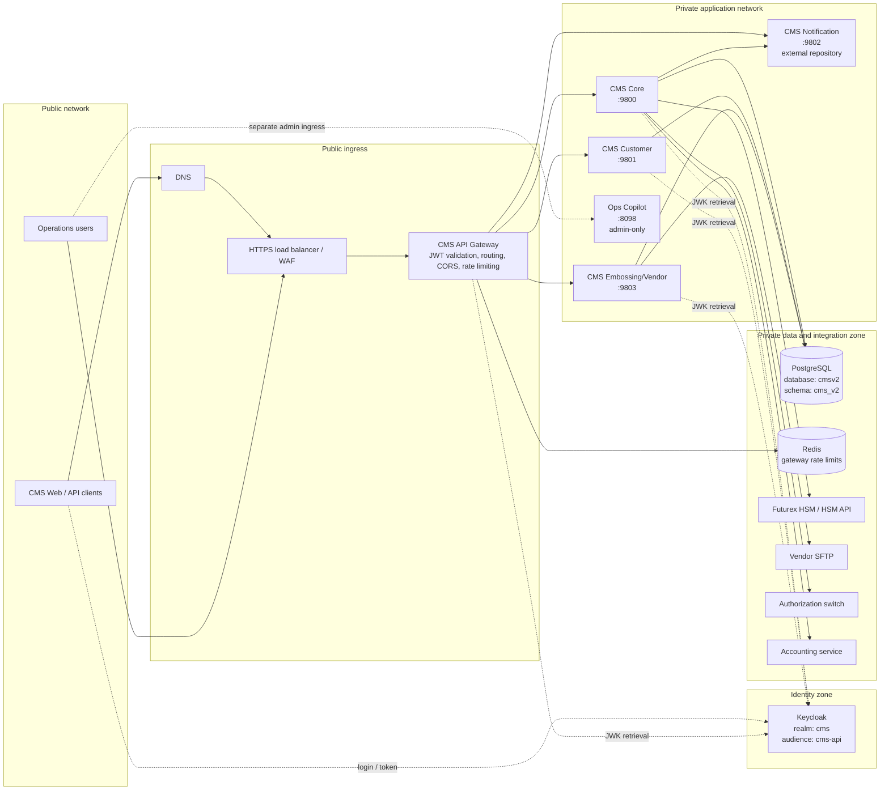
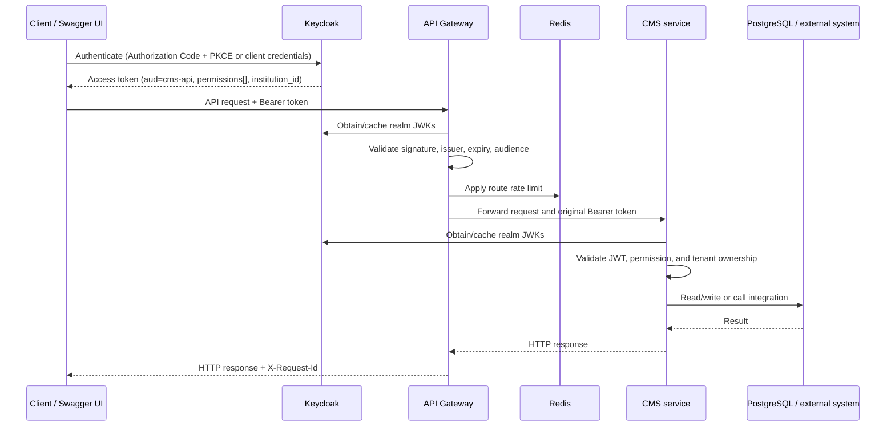
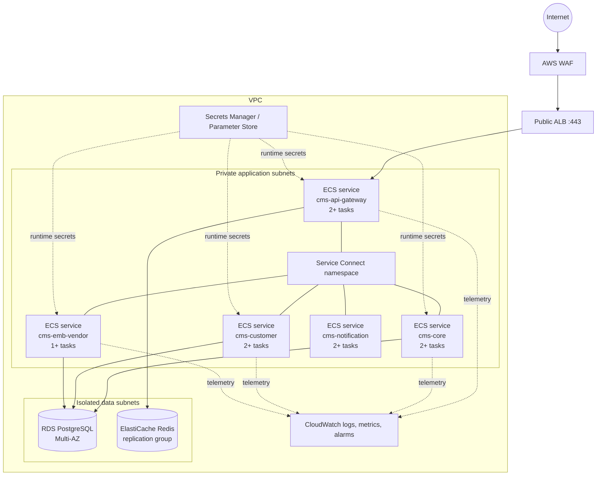

# CMS ecosystem deployment and configuration guide

## 1. Purpose and scope

This runbook describes how to configure, deploy, verify, and operate the CMS
services behind the CMS API Gateway. It is based on the source currently present
in this workspace and covers:

- `cms-api-gateway`
- `cms-core-service`
- `cms_customer` (CMS Customer)
- `cms_emb_vendor_service` (CMS Embossing/Vendor)
- `ops-copilot-service`
- PostgreSQL, Redis, Keycloak, HSM, SFTP, notification, accounting, and switch
  integrations

The gateway configuration also references a notification service, but no
notification-service source directory exists in this workspace. Treat it as an
external dependency until its repository and deployment contract are supplied.

The directory `cms-embossing-vendor-service` appears to be an older/incomplete
implementation that depends on a missing `cms-parent`. This guide uses
`cms_emb_vendor_service`, which is the implementation configured for port 9803
and has the current V2 controllers.

## 2. Entire ecosystem



### Request and authorization flow



## 3. Current service inventory

| Component | Source directory | Current local port | Runtime | Main responsibility | Public through gateway |
|---|---|---:|---|---|---|
| API Gateway | `cms-api-gateway` | `8080` | Java 25, Spring Boot 4.1.1 | Authentication, routing, CORS, rate limiting, aggregated Swagger | Yes |
| CMS Core | `cms-core-service` | `9800` | Java 21, Spring Boot 3.5.10 | Institutions, BINs, products, cards, PIN, HSM keys, lifecycle | Yes |
| CMS Customer | `cms_customer` | `9801` | Java 25, Spring Boot 4.1.1 | Customers, addresses, and external account references | Yes |
| Notification | Not in workspace | `9802` by gateway convention | Unknown | Notification submission and delivery status | Planned |
| Embossing/Vendor | `cms_emb_vendor_service` | `9803` | Java 25, Spring Boot 4.1.1 | Personalisation batches/files, vendor results, courier events, SFTP | Yes, after route correction |
| Ops Copilot | `ops-copilot-service` | `8098` | Java 17, Spring Boot 3.2.0 | Read-only operations assistance | No; separate admin ingress recommended |
| Keycloak | External | `9000` locally | Supported Keycloak release | OIDC issuer and permission claims | Login/JWK endpoints only |
| PostgreSQL | External | `5432` | Supported PostgreSQL release | Shared `cmsv2` database, `cms_v2` schema | No |
| Redis | External | `6379` | Redis 7+ recommended | Gateway rate limiter | No |

Port values above come from current `application.yml` defaults. The gateway
README still mentions port 9700 and older Service Connect ports; update it or set
`SERVER_PORT` explicitly so documentation and runtime cannot diverge.

## 4. Required corrections before production deployment

Do not promote the current repository to production until these items are
resolved and tested:

1. **Fix embossing routing.** The service exposes
   `/cms/api/v2/institutions/{institutionId}/personalisation-*`,
   `/vendor-results`, and `/courier-events`. The gateway currently matches
   `/api/v2/embossing/**` and `/api/v2/vendors/**`, so those requests do not
   reach the service.
2. **Prevent route shadowing.** The broad CMS Core predicate
   `/cms/api/v2/**` appears before embossing. Give each service non-overlapping
   predicates, or place specific predicates before the broad core route and
   exclude the embossing-owned paths from Core.
3. **Standardize the gateway port.** Choose `8080` or `9700` and use it in
   configuration, container metadata, load-balancer rules, health checks, and
   documentation. This guide uses `8080` externally and the current service
   defaults internally.
4. **Create production Dockerfiles.** Only Core and Customer currently have
   Dockerfiles. Gateway, Embossing/Vendor, and Ops Copilot need reproducible,
   non-root, pinned-runtime container builds.
5. **Correct existing Docker health checks.** Core config listens on 9800 but
   its Dockerfile exposes/checks 8081. Customer config defaults to 9801 but its
   Dockerfile forces/checks 8080. Make container ports and `SERVER_PORT` agree.
6. **Add Actuator to Embossing/Vendor.** Its Maven configuration does not
   currently include Actuator. Add it and expose at least `/actuator/health` for
   orchestrator and load-balancer checks.
7. **Decide discovery strategy.** The target described by the gateway is direct
   DNS/ECS Service Connect. Embossing's production profile enables Eureka.
   Disable/remove Eureka when Service Connect is used, or deploy and operate a
   Eureka cluster intentionally. Do not combine both without a clear reason.
8. **Remove development defaults.** Production must not use database password
   `admin`, HSM password `changeit`, fixture card data, mock OTPs, disabled TLS,
   permissive CORS, or SFTP password authentication stored in plain environment
   files.
9. **Move embedded switch credentials out of source.** The switch-sync YAML
   contains default credentials. Rotate any value that has ever been usable and
   source it only from a secrets manager.
10. **Define notification deployment.** Supply its image, port, health endpoint,
    API path, authentication method, and ownership before enabling its gateway
    route.

### Recommended non-overlapping route ownership

| Gateway predicate | Destination | Notes |
|---|---|---|
| `/cms/api/v1/**` | CMS Core | Legacy Core API |
| Core-owned V2 paths | CMS Core | Institutions, BINs, products, cards, HSM, outbox |
| `/api/v2/institutions/{institutionId}/customers/**` | CMS Customer | Current customer controller path |
| `/api/v2/institutions/{institutionId}/accounts/**` | CMS Customer | Current account controller path |
| `/cms/api/v2/institutions/{institutionId}/personalisation-batches/**` | Embossing/Vendor | Batch and file APIs |
| `/cms/api/v2/institutions/{institutionId}/personalisation-files/**` | Embossing/Vendor | File lookup |
| `/cms/api/v2/institutions/{institutionId}/vendor-results/**` | Embossing/Vendor | Vendor callbacks/results |
| `/cms/api/v2/institutions/{institutionId}/courier-events/**` | Embossing/Vendor | Courier callbacks |
| `/api/v1/notifications/**` | Notification | Confirm against missing service contract |

Keep paths unchanged at the gateway unless a deliberate `SetPath` or
`RewritePath` rule is documented. Never include `/webjars` in business API URLs;
that prefix belongs only to Swagger UI static assets.

## 5. Infrastructure preparation

### 5.1 Network layout

Create at least two network tiers:

- Public subnets: HTTPS load balancer/WAF only.
- Private application subnets: gateway tasks and backend service tasks.
- Isolated/private data subnets: PostgreSQL and Redis.

Permit network traffic using security-group identity, not broad CIDR ranges:

| Source | Destination | Port | Purpose |
|---|---|---:|---|
| Load balancer | Gateway | 8080 | Public API ingress |
| Gateway | Core | 9800 | Core API and OpenAPI |
| Gateway | Customer | 9801 | Customer API and OpenAPI |
| Gateway | Notification | 9802 | Notification API |
| Gateway | Embossing/Vendor | 9803 | Embossing API and OpenAPI |
| Gateway | Redis | 6379 | Rate limiting |
| Services | PostgreSQL | 5432 | Application data |
| Gateway/services | Keycloak | 443 (9000 local only) | Issuer discovery/JWKs |
| Core | HSM | 4121/443 as contracted | Cryptographic operations |
| Embossing/Vendor | Vendor SFTP | 22 or contracted port | File delivery |
| Core | Switch/accounting/notification | Contracted HTTPS ports | Downstream integrations |

Backend services must not receive public IPs and must not be registered in the
public load-balancer target group.

### 5.2 PostgreSQL

1. Provision PostgreSQL with encryption at rest, TLS in transit, automated
   backups, point-in-time recovery, and multi-zone availability where required.
2. Create database `cmsv2` and schema `cms_v2`.
3. Create separate login roles for Core, Customer, and Embossing/Vendor. Do not
   share the `postgres` superuser.
4. Grant each role only its required schema/table privileges.
5. Run migrations once in a controlled deployment stage. Core uses Liquibase;
   Customer and Embossing/Vendor use Flyway. Avoid starting many replicas that
   all race to migrate a new schema.
6. Back up and test restore before every destructive or high-risk migration.

Example JDBC endpoints:

```text
jdbc:postgresql://cms-db.internal:5432/cmsv2?sslmode=require
```

### 5.3 Redis

Provision a private, authenticated, encrypted Redis instance. The gateway uses
it for `RequestRateLimiter`; if Redis is unavailable, protected routes may fail.
Use managed replication/failover in production and alarm on connection errors,
memory pressure, evictions, and replication lag.

### 5.4 Keycloak

Follow [KEYCLOAK_CONFIGURATION.md](KEYCLOAK_CONFIGURATION.html). At minimum:

1. Create realm `cms`.
2. Create resource client/audience `cms-api`.
3. Create public UI client with Authorization Code + PKCE, plus separate
   confidential clients for machine callers.
4. Attach the `cms-api-claims` client scope.
5. Add mappers for `aud`, top-level `permissions`, `institution_id`, and tightly
   controlled `platform_access`.
6. Create the documented granular client roles and assign them through groups or
   least-privilege service accounts.
7. Use an HTTPS issuer URL that is identical from the gateway and all services.
8. Verify a token before deployment:

```json
{
  "iss": "https://identity.example.com/realms/cms",
  "aud": ["cms-api"],
  "sub": "...",
  "permissions": ["cms:institution:read"],
  "institution_id": "01a05875-78c8-7ea7-b7cb-164479f1f412"
}
```

### 5.5 Secrets and certificates

Store these in AWS Secrets Manager/SSM, Vault, or an equivalent service:

- database credentials;
- confidential Keycloak client secrets;
- HSM node key, API credentials, PKCS#12 password, keystore, and truststore;
- SFTP private key/password and known-host key;
- switch OAuth client secret and TLS material;
- notification credentials;
- PIN-token signing keystore password.

Inject secret values at runtime. Mount binary certificates/keystores as files.
Never bake secrets into images, commit them to Git, print them in startup logs,
or expose them through Actuator.

## 6. Build and artifact preparation

Use the JDK required by each repository. From the backend workspace:

```bash
cd cms-core-service
./mvnw clean verify

cd ../cms_customer
./mvnw clean verify

cd ../cms_emb_vendor_service
./mvnw clean verify

cd ../cms-api-gateway
./mvnw clean verify

cd ../ops-copilot-service
./mvnw clean verify
```

If a project has no Maven wrapper, use a pinned Maven 3.9.x build image and run
`mvn clean verify`. Do not use `-DskipTests` in the release pipeline.

Build immutable images tagged with the Git commit SHA, scan them for
vulnerabilities and secrets, generate an SBOM, sign them, and push them to the
private registry. Deploy image digests rather than mutable `latest` tags.

## 7. Service configuration

Use the same Keycloak issuer and audience for the gateway and every resource
server. Variable names differ between Customer and the other services.

### 7.1 CMS Core

Required baseline environment:

```dotenv
SERVER_PORT=9800
DB_URL=jdbc:postgresql://cms-db.internal:5432/cmsv2?sslmode=require
DB_USERNAME=<secret reference>
DB_PASSWORD=<secret reference>
DB_SCHEMA=cms_v2
LIQUIBASE_ENABLED=true
JPA_DDL_AUTO=none
CMS_AUTH_ISSUER_URI=https://identity.example.com/realms/cms
CMS_AUTH_JWK_SET_URI=https://identity.example.com/realms/cms/protocol/openid-connect/certs
CMS_AUTH_AUDIENCE=cms-api
CMS_ALLOWED_ORIGINS=https://cms.example.com
CMS_PIN_OTP_MOCK_ENABLED=false
CMS_KAFKA_CARD_EVENTS_ENABLED=false
CMS_OUTBOX_ENABLED=true
CMS_NOTIFICATION_ENABLED=true
CMS_NOTIFICATION_BASE_URL=http://cms-notification:9802
CMS_NOTIFICATION_AUTH_MODE=OAUTH2_CLIENT_CREDENTIALS
CMS_NOTIFICATION_TOKEN_URI=https://identity.example.com/realms/cms/protocol/openid-connect/token
CMS_NOTIFICATION_CLIENT_ID=cms-notification-publisher
CMS_NOTIFICATION_CLIENT_SECRET=<secret reference>
CMS_SWITCH_BASE_URL=https://switch.internal
CMS_ACCOUNTING_BASE_URL=https://accounting.internal
HSM_HOST=<HSM host>
HSM_PORT=4121
HSM_SSL_ENABLED=true
HSM_NODE_KEY=<secret reference>
HSM_P12_PATH=/app/certs/hsm-client.p12
HSM_P12_PASSWORD=<secret reference>
```

Mount all HSM and PIN keystores read-only. Validate the HSM and downstream
connectivity before accepting traffic. Use one controlled Core task/job to apply
Liquibase migrations, then start the remaining replicas.

### 7.2 CMS Customer

```dotenv
SERVER_PORT=9801
DATASOURCE_URL=jdbc:postgresql://cms-db.internal:5432/cmsv2?sslmode=require
DATASOURCE_USERNAME=<secret reference>
DATASOURCE_PASSWORD=<secret reference>
DB_SCHEMA=cms_v2
FLYWAY_ENABLED=true
KEYCLOAK_ISSUER_URI=https://identity.example.com/realms/cms
KEYCLOAK_JWK_SET_URI=https://identity.example.com/realms/cms/protocol/openid-connect/certs
KEYCLOAK_AUDIENCE=cms-api
```

Customer creates `customer_service_schema_history`. Confirm that its baseline
version matches the schema already installed by the platform migrations before
first production startup.

### 7.3 CMS Embossing/Vendor

```dotenv
SERVER_PORT=9803
SPRING_PROFILES_ACTIVE=prod
SPRING_DATASOURCE_URL=jdbc:postgresql://cms-db.internal:5432/cmsv2?sslmode=require
SPRING_DATASOURCE_USERNAME=<secret reference>
SPRING_DATASOURCE_PASSWORD=<secret reference>
CMS_AUTH_ISSUER_URI=https://identity.example.com/realms/cms
CMS_AUTH_JWK_SET_URI=https://identity.example.com/realms/cms/protocol/openid-connect/certs
CMS_AUTH_AUDIENCE=cms-api
CMS_SECURITY_ALLOWED_ORIGINS=https://cms.example.com
CMS_OUTBOX_ENABLED=true
EMBOSSING_V2_FIXTURE_CARD_DATA=false
EMBOSSING_RUN_ON_STARTUP=false
EMBOSSING_SFTP_ENABLED=true
EMBOSSING_SFTP_HOST=<vendor SFTP host>
EMBOSSING_SFTP_PORT=22
EMBOSSING_SFTP_USERNAME=<secret reference>
EMBOSSING_SFTP_PASSWORD=<secret reference or prefer private key>
EMBOSSING_SFTP_REMOTE_PATH=/upload
EMBOSSING_SFTP_STRICT_HOST_KEY_CHECKING=true
EMBOSSING_SFTP_MAX_RETRIES=3
```

The current production profile defaults `SERVER_PORT` to 8080, while the shared
configuration hard-codes 9803. Set `SERVER_PORT=9803` explicitly. If using ECS
Service Connect, disable Eureka and omit `EUREKA_CLIENT_SERVICE_URL` after the
code/configuration has been aligned.

### 7.4 CMS API Gateway

```dotenv
SERVER_PORT=8080
CMS_CORE_URI=http://cms-core:9800
CUSTOMER_SERVICE_URI=http://cms-customer:9801
NOTIFICATION_SERVICE_URI=http://cms-notification:9802
EMB_VENDOR_SERVICE_URI=http://cms-emb-vendor:9803
REDIS_HOST=cms-redis.internal
REDIS_PORT=6379
CMS_AUTH_ISSUER_URI=https://identity.example.com/realms/cms
CMS_AUTH_JWK_SET_URI=https://identity.example.com/realms/cms/protocol/openid-connect/certs
CMS_AUTH_AUDIENCE=cms-api
CMS_ALLOWED_ORIGINS=https://cms.example.com
GATEWAY_LOG_LEVEL=INFO
```

Use the service-discovery names provided by the deployment platform. For ECS
Service Connect, enable the gateway as a client and each backend as a
client-server service in the same namespace. The URI ports must match the
Service Connect client aliases, not stale README examples.

### 7.5 Notification service

Before deployment, obtain and document:

- repository and image ownership;
- container/listener port (gateway assumes 9802 locally);
- health and OpenAPI endpoints;
- actual API predicate (gateway assumes `/api/v1/notifications/**`);
- database/message-broker dependencies;
- accepted Keycloak audience/permissions;
- Core-to-notification authentication contract.

Leave the gateway route and Core notification publishing disabled if these are
not known. A configured route to a nonexistent service produces connection
errors and may cause retry amplification.

### 7.6 Ops Copilot

```dotenv
SERVER_PORT=8098
```

Ops Copilot is currently read-only and has no Keycloak resource-server
configuration. Keep it off the public gateway and expose it only through a
separate authenticated administrative ingress. Add authentication and
authorization before any production exposure. Its Swagger entry is intentionally
disabled in the gateway.

## 8. Recommended deployment topology (AWS ECS example)



For each ECS service:

1. Use private subnets and no public IP.
2. Run as a non-root user with a read-only root filesystem where feasible.
3. Set CPU/memory reservations and JVM container memory percentages.
4. Configure a task health check and deployment circuit breaker with rollback.
5. Use at least two tasks across availability zones for stateless online
   services. Confirm whether embossing scheduling requires leader election before
   running multiple scheduler replicas.
6. Send structured logs to the central logging platform without PAN, PIN, token,
   credentials, or other PCI/PII values.
7. Enable Service Connect with stable names (`cms-core`, `cms-customer`,
   `cms-notification`, `cms-emb-vendor`).
8. Use rolling or blue/green deployment with minimum healthy capacity.

## 9. Deployment order

```mermaid
flowchart LR
    A[1. Network, DNS, TLS] --> B[2. PostgreSQL and Redis]
    B --> C[3. Keycloak realm and clients]
    C --> D[4. Secrets and certificates]
    D --> E[5. Database migrations]
    E --> F[6. Backend services]
    F --> G[7. Backend health and direct private tests]
    G --> H[8. API Gateway]
    H --> I[9. Gateway route and Swagger tests]
    I --> J[10. Enable public traffic]
    J --> K[11. Observe and sign off]
```



Detailed sequence:

1. Provision networks, private DNS/Service Connect, security groups, TLS
   certificates, WAF, and load balancer.
2. Provision PostgreSQL and Redis; verify TLS and backup policies.
3. Configure Keycloak and validate a representative user and machine token.
4. Create secret references and mount certificates/keystores.
5. Take a backup, apply Liquibase/Flyway migrations in a controlled stage, and
   validate migration history.
6. Deploy Notification (when available), Core, Customer, and Embossing/Vendor
   with zero public exposure.
7. From a private diagnostic task, verify service health, `/api-docs`, database,
   Keycloak, HSM, SFTP, switch, accounting, and notification connectivity.
8. Deploy the gateway after correcting predicates and confirming Redis access.
9. Validate every gateway route and Swagger definition.
10. Register healthy gateway tasks behind the HTTPS load balancer and gradually
    shift traffic.
11. Monitor errors, latency, JVM/DB/Redis saturation, authentication failures,
    rate limiting, outbox backlog, HSM health, and SFTP delivery.

## 10. Health, readiness, and observability

Use separate liveness and readiness signals where supported:

- Liveness: process and Spring context are alive; avoid dependency checks that
  restart healthy instances during a downstream outage.
- Readiness: instance can authenticate requests and reach mandatory dependencies.
- Startup: allow schema validation, JWK retrieval, and pools to initialize.

Recommended endpoints:

| Component | Health endpoint | Expected result |
|---|---|---|
| Gateway | `/actuator/health` | HTTP 200 |
| Core | `/actuator/health` | HTTP 200 after Docker/config port correction |
| Customer | `/actuator/health` | HTTP 200 after Docker/config port correction |
| Embossing/Vendor | Add `/actuator/health` | HTTP 200 |
| Ops Copilot | `/actuator/health` | HTTP 200 on admin network |

Create dashboards and alarms for:

- HTTP 4xx/5xx by route and service;
- p50/p95/p99 latency;
- gateway connection failures and rate-limit rejections;
- JWT issuer/audience/signature failures (counts only; never log tokens);
- JVM heap, GC, threads, container CPU/memory, and restarts;
- database connections, slow queries, locks, storage, and replication;
- Redis latency, connections, evictions, and failover;
- Core outbox depth, retry age, and dead letters;
- HSM connection health and operation latency;
- embossing batch/file/SFTP failures.

Propagate `X-Request-Id` into logs and downstream calls. The gateway removes
caller-supplied identity headers and creates or validates the request ID.

## 11. Verification checklist

### 11.1 Infrastructure and discovery

From the gateway task/network namespace:

```bash
curl -fsS http://cms-core:9800/actuator/health
curl -fsS http://cms-customer:9801/actuator/health
curl -fsS http://cms-emb-vendor:9803/actuator/health
curl -fsS http://cms-core:9800/api-docs
curl -fsS http://cms-customer:9801/api-docs
curl -fsS http://cms-emb-vendor:9803/api-docs
```

The Embossing health request becomes valid only after Actuator is added. A
gateway `Connection refused` means the configured DNS name/port has no listening
service; it is not a Swagger problem.

### 11.2 Gateway and Swagger

```bash
curl -fsS https://api.example.com/actuator/health
curl -fsS https://api.example.com/docs/core/api-docs
curl -fsS https://api.example.com/docs/customer/api-docs
curl -fsS https://api.example.com/docs/embossing-vendor/api-docs
```

Open:

```text
https://api.example.com/swagger-ui.html
```

The **Select a definition** list should show Core, Customer, and
Embossing/Vendor. The OpenAPI JSON must contain a bearer security scheme for the
Swagger **Authorize** button to appear; the gateway cannot invent it when the
downstream document omits it.

### 11.3 Authentication and authorization

```bash
curl -i https://api.example.com/cms/api/v2/institutions

curl -i \
  -H "Authorization: Bearer ${ACCESS_TOKEN}" \
  'https://api.example.com/cms/api/v2/institutions?status=ACTIVE'
```

Expected outcomes:

- No/invalid token: `401 Unauthorized`.
- Valid token without required permission: `403 Forbidden`.
- Valid token with wrong `institution_id`: `403 Forbidden` on tenant-scoped API.
- Valid token with correct permission and tenant: business response (`2xx` or a
  domain-specific `4xx`, not gateway `401/404/500`).

Validate at least one read and one write for each service, plus negative tests
for missing permission, wrong tenant, expired token, wrong issuer, and wrong
audience.

### 11.4 Route ownership

Check gateway Actuator routes using a token with `cms:gateway:admin`, or inspect
startup logs in a protected environment. For every public predicate, confirm the
selected route ID and destination. Specifically verify embossing URLs are not
handled by `cms-core-service`.

## 12. Release, rollback, and disaster recovery

Before release:

- record image digests, schema version, configuration revision, and secret
  version;
- confirm backup completion and restore instructions;
- verify forward and backward compatibility between gateway and services;
- define success/error thresholds and an owner for the release window.

Rollback application tasks to the previous image digest when health or SLO
thresholds fail. Database rollback requires a migration-specific plan; do not
automatically run destructive down migrations. Prefer backward-compatible
expand/migrate/contract schema changes so the previous and new application
versions can coexist during rollout.

Test database restore, Keycloak realm export/restore, Redis failover, regional
DNS/load-balancer recovery, and reconstruction of all runtime configuration from
infrastructure-as-code and secret references.

## 13. Production sign-off checklist

- [ ] Gateway predicates are non-overlapping and integration-tested.
- [ ] Gateway and all service ports agree across YAML, containers, service
      discovery, health checks, and load balancers.
- [ ] Notification service contract is supplied or all notification routes/calls
      are disabled.
- [ ] Every online service has a non-root image and working health endpoint.
- [ ] Keycloak issuer, JWK URL, audience, permissions, and tenant claims verified.
- [ ] No backend service or database/cache has public exposure.
- [ ] TLS is enabled at ingress and for sensitive/private integrations.
- [ ] Development credentials, fixture data, mock OTP, and permissive SFTP
      settings are disabled.
- [ ] HSM, switch, accounting, notification, and SFTP failure modes tested.
- [ ] Database migrations and rollback compatibility reviewed.
- [ ] Logs are free of PAN, PIN, access tokens, passwords, and private keys.
- [ ] Metrics, dashboards, alerts, tracing/request IDs, and on-call runbooks exist.
- [ ] Backups and restore procedures have been tested.
- [ ] Capacity, rate limits, timeouts, retries, and circuit breakers load-tested.

## 14. Source-of-truth files

- Gateway routing and runtime settings:
  `cms-api-gateway/src/main/resources/application.yml`
- Gateway security: `cms-api-gateway/src/main/java/com/xenomi/cms/gateway/config/SecurityConfig.java`
- Keycloak contract: `cms-api-gateway/docs/KEYCLOAK_CONFIGURATION.md`
- Core runtime settings: `cms-core-service/src/main/resources/application.yml`
- Core switch settings:
  `cms-core-service/src/main/resources/application-switch-sync.yml`
- Customer runtime settings: `cms_customer/src/main/resources/application.yml`
- Embossing/Vendor runtime settings:
  `cms_emb_vendor_service/src/main/resources/application.yml`
- Embossing/Vendor production overrides:
  `cms_emb_vendor_service/src/main/resources/application-prod.yml`
- Ops Copilot runtime settings:
  `ops-copilot-service/src/main/resources/application.yml`

Update this runbook whenever a route, port, dependency, security claim, secret,
health endpoint, or deployment platform contract changes.
