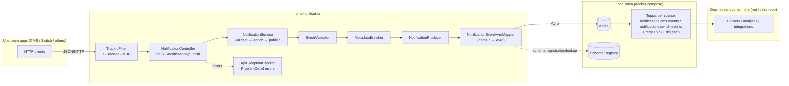
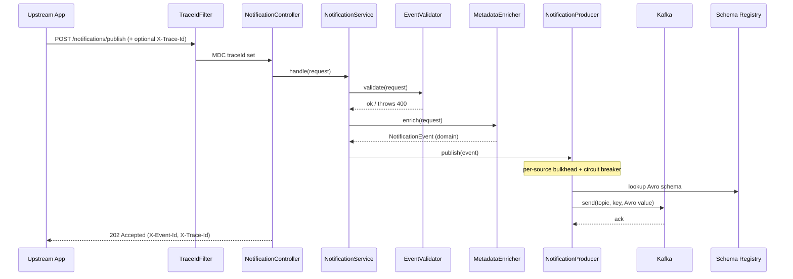

# CMS Notification Service

### What this repo contains
This repository implements a **notification event hub**:

- Upstream systems (e.g., **CMS** and **Switch**) send **notification intents** to a REST API.
- The service **validates** and **enriches** the request into a canonical event.
- The event is published to **Kafka** as an **Avro** message, registered in **Schema Registry**, for downstream consumers.

It is intentionally **not** a “send email/SMS” system. Delivery is expected to be handled by downstream services that consume Kafka events.

---

## Project layout

Single-module Maven project (`com.lps:cms-notification`, Java 25, Spring Boot 4.1.1):

```
cms_notification/
├── pom.xml
├── Dockerfile
├── docker-compose.yml
└── src/
    ├── main/
    │   ├── avro/NotificationEvent.avsc
    │   ├── java/com/lps/cms/notification/
    │   │   ├── CmsNotificationApplication.java
    │   │   ├── controller/          # REST ingress
    │   │   ├── service/             # validate, enrich, orchestrate
    │   │   ├── producer/            # Kafka publish, Avro mapping, partition keys
    │   │   ├── config/              # Kafka, properties, trace filter
    │   │   ├── exception/           # API error handling (ProblemDetail)
    │   │   └── model/               # domain records
    │   └── resources/
    │       ├── application.yml          # shared config
    │       ├── application-dev.yml
    │       ├── application-prod.yml
    │       └── application-test.yml
    └── test/java/...
```

Avro types are generated at build time into `com.cms.notification.avro` (schema namespace).

---

## Current architecture (as implemented)

### High-level data flow



### Service responsibilities

- **Ingress**: REST endpoint accepts a JSON `NotificationRequest`.
- **Validation**: Bean Validation plus business rules (`EventValidator`).
- **Enrichment**: canonical `NotificationEvent` with ids, timestamps, metadata, defaults.
- **Egress**: synchronous publish to Kafka with Avro + Schema Registry.
- **Observability**: structured logs with `traceId` and `eventId` in MDC; correlation headers on HTTP responses.

There is **no consumer** in this repository (no `@KafkaListener`); consumption is intended for other services.

---

## REST API (ingress)

### Endpoint
- **`POST /notifications/publish`**
  - Returns **`202 Accepted`** when the event is published to Kafka (or when an identical prior publish is replayed).
  - Request header **`X-Institution-Id`** (**required**): stamped by `cms-api-gateway`. Must match body `tenantId` (same identity for now).
  - Response header **`X-Event-Id`**: caller-supplied event id.
  - Response header **`X-Idempotent-Replay: true`**: set when this call did not publish again (HTTP retry of an already-accepted event).
  - Request/response header **`X-Trace-Id`**: distributed trace id (generated if omitted).

### Input model (`NotificationRequest`)

| Field | Required | Notes |
|-------|----------|--------|
| `eventId` | **yes** | **Caller-supplied idempotency key**, derived from the business fact (e.g. `txn-42-APPROVED`). Retries after a `503`/timeout MUST reuse the same value. |
| `eventType` | yes | Business event name |
| `tenantId` | **yes** | Must equal `X-Institution-Id`; prefixes every partition key |
| `eventSource` | **yes** | `CMS` or `SWITCH` (case-insensitive). **Determines the target Kafka topic.** |
| `payload` | yes | JSON object (must be JSON-serializable, max `256KB` serialized by default) |
| `customerId` | no | Customer scope for per-customer partition ordering |
| `aggregateType` / `aggregateId` | no | Must be provided together |
| `correlationId` | no | Cross-service correlation |
| `channels` | no | Max 10 delivery channel hints |
| `priority` | no | `HIGH`, `MEDIUM` (default), or `LOW` |

### Error responses

`ApiExceptionHandler` returns [RFC 9457](https://www.rfc-editor.org/rfc/rfc9457) `ProblemDetail` JSON. Retryable responses carry a `Retry-After` header (seconds):

| HTTP status | Retry-After | Cause |
|-------------|-------------|--------|
| `400` | — | Bean Validation, missing `X-Institution-Id`, tenant/institution mismatch, or other `ValidationException` |
| `409` | `1` | Same event is already publishing in-flight; retry shortly with the same `eventId` |
| `413` | — | Serialized payload exceeds `app.notification.producer.max-payload-size` |
| `429` | `1` | Per-source publish concurrency cap reached (bulkhead full) |
| `503` | `5` | Kafka publish failure or timeout (`NotificationPublishException`) |
| `503` | `10` | Circuit open for the event's source — Kafka degraded, failing fast |
| `500` | — | Unexpected server error |

On any retryable failure, resubmit with the **same `eventId`**, **`eventSource`**, and **`X-Institution-Id`**.

### HTTP idempotency (Redis)

Kafka `enable.idempotence` only dedupes broker-side produce retries. This service additionally gates HTTP retries:

| Key | `(X-Institution-Id, eventSource, eventId)` |
|-----|-----------------------------------------------|
| Store | Redis (`SET NX` + TTL) in prod/dev; in-memory only for tests |
| Flow | claim `IN_PROGRESS` → publish → mark `COMPLETED`; on publish failure → abandon claim |
| Replay | `COMPLETED` → `202` + `X-Idempotent-Replay: true`, **no second Kafka send** |
| TTL | default `24h` (`app.notification.idempotency.ttl`) |

**Downstream consumers must still dedupe** on the same key (or `eventId` if globally unique) before SMS/email — Kafka redelivery is independent of HTTP retries.

---

## Domain-to-event pipeline

### Controller (`controller/NotificationController`)
- Maps `/notifications/publish`
- Validates the body (`@Valid`)
- Delegates to `NotificationService`
- Returns `202` with `X-Event-Id`

### Service orchestration (`service/NotificationService`)
1. `EventValidator.validate(institutionId, request)` (includes tenant = institution)
2. `MetadataEnricher.enrich(request)` → domain `NotificationEvent`
3. Idempotency gate on `(institutionId, source, eventId)` — replay or claim
4. `NotificationProducer.publish(event)` only when this call owns the claim
5. Mark claim `COMPLETED` (or `abandon` on publish failure)

### Validation rules (`service/EventValidator`)
- `eventId`, `eventType`, `tenantId`, `eventSource`, `payload` are required (Bean Validation)
- `X-Institution-Id` is required
- `tenantId` must equal `X-Institution-Id`
- `eventSource` must match an `EventSource` enum value (`CMS`, `SWITCH`)
- `aggregateType` and `aggregateId` must appear together
- Failures raise `ValidationException` → `400` (stray `IllegalArgumentException`s are treated as server bugs → `500`)

### Enrichment rules (`service/MetadataEnricher`)
- **`eventId` / `tenantId` / `eventSource`**: caller-supplied and mandatory — the service never invents identity or routing values
- **`eventTime`**: `Instant.now()`
- **`version`**: `"1.0"`
- **`channels`**: empty list if omitted
- **`priority`**: `MEDIUM` if omitted
- **`metadata.traceId`**: from `X-Trace-Id` / MDC, or generated UUID
- **`metadata.retryCount`**: `0` on first publish

### Trace filter (`config/TraceIdFilter`)
- Reads `X-Trace-Id` or generates a UUID
- Puts `traceId` in SLF4J MDC for the request
- Echoes `X-Trace-Id` on the response
- Clears MDC after the request (including `eventId`)

---

## Kafka topic design

Each upstream source owns an isolated topic set, so CMS and Switch streams can be scaled, retained, and consumed independently:

| Topic | Purpose |
|-------|---------|
| `notifications.cms.events` | CMS ingress topic (**this service publishes here for `eventSource=CMS`**) |
| `notifications.switch.events` | Switch ingress topic (**this service publishes here for `eventSource=SWITCH`**) |
| `notifications.{cms,switch}.events.retry.1..3` | Per-source retry tiers (downstream consumers) |
| `notifications.{cms,switch}.events.dlq` | Per-source dead letter queues |

The producer resolves the topic from the event's `EventSource`; the application fails at startup if any source lacks topic configuration, so a misconfigured deployment can never accept an event it cannot route.

All topics are created locally with **12 partitions** and replication factor **1** (`docker-compose` `kafka-init`).

### Partition keys (main + retry + DLQ)

`tenantId` is mandatory, so every key is tenant-prefixed and deterministic — the same event content always yields the same key regardless of which producer sent it:

| Key | When used |
|-----|-----------|
| `tenantId:customerId` | Customer present — per-customer ordering within a tenant |
| `tenantId:aggregateType:aggregateId` | No customer, aggregate provided |
| `tenantId` | Fallback — tenant-level ordering |

Implemented in `producer/NotificationPartitionKey`.

### Publishing (`producer/NotificationProducer`)

- **Topic**: resolved per event from `app.notification.topics.sources.<source>.events` (`notifications.cms.events` or `notifications.switch.events`)
- **Key**: partition key table above
- **Value**: Avro `NotificationEvent` via Confluent serializer
- **Semantics**: blocking publish bounded by a single budget. `app.notification.producer.delivery-timeout` (default `3s`) drives the Kafka `delivery.timeout.ms`, and the app waits `delivery-timeout + await-buffer` (default buffer `1s`) on the send future. The app always waits longer than the producer's delivery deadline, so a failure is never reported while a record is still in flight (avoiding phantom duplicates). Legitimate client retries remain at-least-once, so downstream consumers must dedupe on `eventId`.
- **Producer settings**: `acks=all`, idempotence enabled, Snappy compression (see `application.yml`). Note Kafka requires `delivery.timeout.ms >= request.timeout.ms + linger.ms` (request timeout default `2500ms`).

### Resilience (per-source guards)

Each `EventSource` gets an independent **bulkhead** and **circuit breaker** (Resilience4j), created as `kafka-publish-CMS` / `kafka-publish-SWITCH` from the `default` configs in `application.yml`:

- **Bulkhead** (default 50 concurrent per source): caps in-flight publishes so one upstream's burst or slowdown cannot exhaust the servlet thread pool and starve the other. When full → `429` + `Retry-After: 1`.
- **Circuit breaker** (default: opens at 50% failures over a 20-call window, min 10 calls; half-opens after 10s): during sustained Kafka degradation callers get an immediate `503` + `Retry-After: 10` instead of holding a thread for the full delivery budget. Only `NotificationPublishException` is recorded as failure — client errors (400/413) are raised before the guards and never trip it.
- Circuit breaker state appears in `/actuator/health` (for ops/alerting) but is deliberately **not** in the readiness group: a Kafka-wide outage would otherwise take every replica out of rotation and turn fast retryable 503s into gateway connect errors.

### Metrics

- `notifications.publish` timer, tagged `source` (`CMS`/`SWITCH`) and `outcome` (`success`/`failure`)
- Resilience4j circuit breaker/bulkhead metrics via Micrometer
- Prometheus scrape endpoint: `/actuator/prometheus`

Retry and DLQ topic names are configured for downstream use; this service does not publish to them yet.

Topic names are bound per source under `app.notification.topics.sources.{cms,switch}`:

| Property | Default | Env override |
|----------|---------|--------------|
| `sources.cms.events` | `notifications.cms.events` | `NOTIF_TOPIC_CMS_EVENTS` |
| `sources.cms.retry-1..3` | `notifications.cms.events.retry.1..3` | `NOTIF_TOPIC_CMS_RETRY_1..3` |
| `sources.cms.dlq` | `notifications.cms.events.dlq` | `NOTIF_TOPIC_CMS_DLQ` |
| `sources.switch.events` | `notifications.switch.events` | `NOTIF_TOPIC_SWITCH_EVENTS` |
| `sources.switch.retry-1..3` | `notifications.switch.events.retry.1..3` | `NOTIF_TOPIC_SWITCH_RETRY_1..3` |
| `sources.switch.dlq` | `notifications.switch.events.dlq` | `NOTIF_TOPIC_SWITCH_DLQ` |

`KafkaProducerConfig` is disabled under the `test` profile (`@Profile("!test")`).

---

## Event contract (Avro)

### Schema
- `src/main/avro/NotificationEvent.avsc`
- Namespace: `com.cms.notification.avro` (generated Java types)

Fields include: `eventId`, `eventType`, `eventSource`, `eventTime`, `version`, `tenantId`, optional aggregate/customer/correlation fields, `channels[]`, `priority` enum, `payload` (JSON string), and `metadata` (`tenantId`, `traceId`, `retryCount`).

### Mapping (`producer/NotificationEventAvroMapper`)
- Maps domain `NotificationEvent` → Avro builder
- Serializes `payload` with Jackson to a string field
- Throws `IllegalArgumentException` if the payload is not JSON-serializable

---

## Configuration

### Spring profiles

| Profile | File | Purpose |
|---------|------|---------|
| `dev` (default) | `application-dev.yml` | Local Kafka defaults (`localhost:9092`), DEBUG app logs, health details always |
| `prod` | `application-prod.yml` | Kafka URLs from env only, quieter logs, health details hidden |
| `test` | `application-test.yml` | Placeholder Kafka URLs for unit tests |

Activate via `SPRING_PROFILES_ACTIVE` (default `dev` in `application.yml`). Docker Compose sets `dev` for `notification-service`.

### Common environment variables

| Variable | Description |
|----------|-------------|
| `SPRING_PROFILES_ACTIVE` | `dev`, `prod`, or `test` |
| `KAFKA_BOOTSTRAP_SERVERS` | Kafka brokers (**required** in `prod`) |
| `SCHEMA_REGISTRY_URL` | Schema Registry URL (**required** in `prod`) |
| `NOTIF_DELIVERY_TIMEOUT` | Producer delivery budget; drives `delivery.timeout.ms` (default `3s`) |
| `NOTIF_AWAIT_BUFFER` | Extra time the app waits beyond the delivery budget (default `1s`) |
| `NOTIF_MAX_PAYLOAD_SIZE` | Max serialized payload size (default `256KB`; rejected with `413`) |
| `REDIS_HOST` / `REDIS_PORT` / `REDIS_PASSWORD` | Redis for HTTP idempotency (**required** when `store=redis`) |
| `NOTIF_IDEMPOTENCY_STORE` | `redis` (default) or `memory` (tests / single JVM only) |
| `NOTIF_IDEMPOTENCY_TTL` | Idempotency key retention (default `24h`) |
| `NOTIF_TOPIC_*` | Topic name overrides |
| `NOTIF_CB_*` | Circuit breaker tuning (window size, min calls, failure rate, open wait) |
| `NOTIF_BULKHEAD_MAX_CONCURRENT` | Max concurrent publishes per source (default `50`) |
| `SCHEMA_AUTO_REGISTER` | Schema auto-registration (default `false`; `true` only in `dev`) |
| `KAFKA_PRODUCER_*` | Producer client tuning (retries, compression, timeouts) |
| `APP_LOG_LEVEL` | Override `com.lps.cms.notification` log level in base config |

### Logging

Console pattern includes `traceId` and `eventId` from MDC:

```
%d ... traceId=... eventId=... %logger - %msg%n
```

Profile-specific levels are in `application-dev.yml` / `application-prod.yml`.

### Actuator

- Exposed: `health`, `info`, `metrics`, `prometheus`
- Kubernetes-style liveness/readiness probes enabled
- Circuit breaker states surface in `/actuator/health` (not in the readiness group)

---

## Local development

### Prerequisites
- Java 25
- Maven 3.9+
- Docker (for Kafka + Schema Registry)

### Run infrastructure only
```bash
docker compose up -d kafka schema-registry kafka-init redis
```

### Run the application (host)
```bash
mvn spring-boot:run
# or explicitly:
SPRING_PROFILES_ACTIVE=dev mvn spring-boot:run
```

Uses `localhost:9092` and `http://localhost:8081` by default (`application-dev.yml`).

### Run full stack (infra + service)
```bash
docker compose up --build
```

Service listens on **http://localhost:8080**.

### Tests
```bash
mvn test
```

### Example request
```bash
curl -s -D - -X POST http://localhost:8080/notifications/publish \
  -H "Content-Type: application/json" \
  -H "X-Institution-Id: tenant-a" \
  -H "X-Trace-Id: my-trace-123" \
  -d '{
    "eventId": "txn-42-APPROVED",
    "eventType": "TRANSACTION_APPROVED",
    "customerId": "cust-42",
    "tenantId": "tenant-a",
    "eventSource": "CMS",
    "channels": ["email"],
    "priority": "HIGH",
    "payload": { "amount": 100, "currency": "USD" }
  }'
```

Expect `HTTP/1.1 202` with `X-Event-Id` and `X-Trace-Id`. A second identical call returns `202` with `X-Idempotent-Replay: true` and does not publish again.

---

## Typical request lifecycle



---

## Extension points / next steps

- **Authentication/authorization**: handled upstream by `cms-api-gateway` (mTLS + institution partitioning headers); revisit if this service is ever exposed directly
- **Kafka transport security**: SASL_SSL + broker ACLs for the producer principal in prod
- **Transactional outbox**: planned evolution if an upstream cannot retry durably AND notification delivery becomes a hard compliance requirement (e.g. mandated transaction alerts)
- **Downstream consumer(s)** for delivery and retry/DLQ routing across provisioned topics
- **Schema evolution**: CI/CD registration pipeline with compatibility checks (auto-register is already off outside `dev`)
- **End-to-end tests** (Testcontainers: HTTP → Kafka → consume and assert the Avro record)
